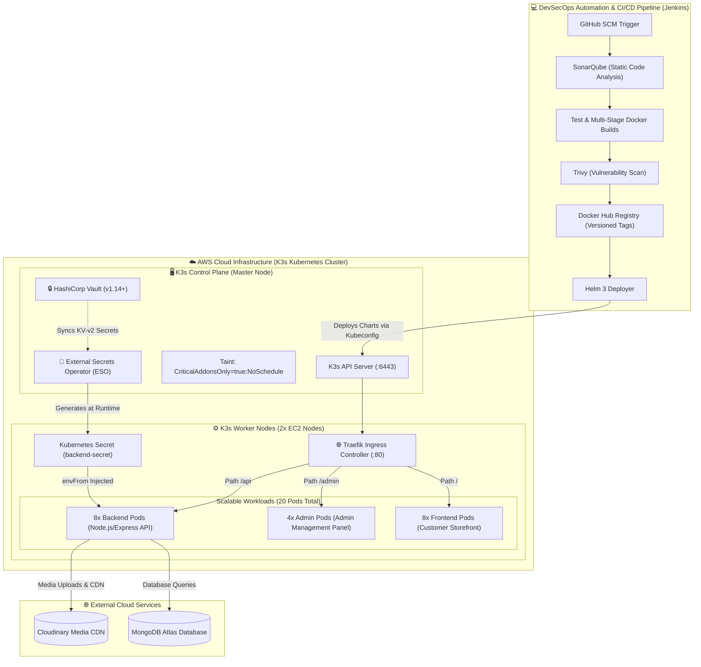

# 🛒 X-Shop: High-Availability E-Commerce Platform — End-to-End DevSecOps Implementation


---

## 📌 Project Overview & Role Statement

**X-Shop** is a full-stack, 3-tier e-commerce web platform consisting of a **Customer Storefront (React/Vite)**, an **Admin Dashboard (React/Vite)**, and a **RESTful Backend API (Node.js/Express)** integrated with **MongoDB Atlas** and **Cloudinary**.

> 💡 **Application Development vs. DevSecOps Engineering Context:**
> - **Web Application Layer:** The 3-tier application codebase (`frontend`, `admin`, and `backend`) was prototyped using modern full-stack web stacks.
> - **DevSecOps & Cloud Engineering (My Core Contribution):** My primary engineering focus was architecting and delivering a **production-grade, zero-trust, automated DevSecOps lifecycle**:
>   - **Infrastructure as Code (IaC):** Multi-node AWS EC2 provisioning via Terraform.
>   - **Configuration Management:** Automated K3s cluster bootstrap, node joins, and Vault/ESO provisioning via Ansible.
>   - **Enterprise Zero-Trust Secrets Management:** Native HashiCorp Vault deployment integrated with External Secrets Operator (ESO) — permanently removing plaintext secrets from Git repositories and Helm deployment values.
>   - **Shift-Left Security:** Automated CI/CD scanning with SonarQube, Gitleaks, and Trivy image vulnerability assessment.
>   - **Unified Ingress & Microservices Orchestration:** High-availability K3s orchestration with Traefik Ingress reverse proxying path-based traffic on standard HTTP Port 80 (`/`, `/admin`, `/api`).

---

## 🏗️ System Architecture & DevSecOps Lifecycle



---

## 🔒 Enterprise Secrets Management: HashiCorp Vault & External Secrets Operator (ESO)

To achieve strict **Zero-Trust Security** and prevent credential leakage in source control:

1. **HashiCorp Vault Deployment:**
   - Installed inside the K3s cluster under the dedicated `vault` namespace.
   - Configured with tolerations to safely run alongside the master control plane without compromising worker compute capacity.
2. **External Secrets Operator (ESO):**
   - Deployed with custom CRDs (`SecretStore` and `ExternalSecret` on `apiVersion: external-secrets.io/v1`).
   - Watches Vault KV-v2 path `secret/data/x-shop/backend` and automatically reconciles secrets into the native Kubernetes Secret `backend-secret`.
3. **Zero Plaintext Secrets in Git:**
   - Completely eradicated `secrets.yml` files.
   - Historical Git commits purged permanently using `git-filter-repo`.
   - Comprehensive `.gitignore` and `.gitleaksignore` rules preventing future accidental commits.
4. **All 11 Production Secrets Managed via Vault:**
   - `PORT`, `JWT_SECRET`, `ADMIN_EMAIL`, `ADMIN_PASSWORD`, `MONGODB_URI`
   - `CLOUDINARY_API_KEY`, `CLOUDINARY_SECRET_KEY`, `CLOUDINARY_NAME`
   - `STRIPE_SECRET_KEY`, `RAZORPAY_KEY_ID`, `RAZORPAY_KEY_SECRET`

---

## 🌐 Unified Ingress & Single-Port Access Architecture

Rather than opening scattered NodePorts (such as `30003`) across EC2 security groups, the application is fronted by **Traefik Ingress** on standard HTTP **Port 80**:

| Route | Destination Service | Description | Port | Status |
| :--- | :--- | :--- | :---: | :---: |
| `http://<Node_IP>/` | `frontend-service:80` | Customer-facing React Storefront | **80** | `200 OK` |
| `http://<Node_IP>/admin` | `admin-service:80` | Store Administration Dashboard | **80** | `200 OK` |
| `http://<Node_IP>/api` | `backend-service:80` | REST API Endpoints | **80** | `200 OK` |

### Key Ingress & Microservice Routing Fixes:
1. **IngressClass Alignment:** Configured `ingressClassName: traefik` in Helm templates to natively bind to K3s's built-in Traefik load balancer.
2. **Admin SPA Subpath Routing:** Resolved Vite base path `/admin/` asset lookup loops by introducing an internal Nginx symlink (`/usr/share/nginx/html/admin`) and a Kubernetes `postStart` lifecycle hook, preventing internal 500 redirection cycles.
3. **Dynamic Client Reverse-Proxying:** Updated `backendUrl` in both `frontend` and `admin` to relative paths (`""`), seamlessly proxying API requests through Port 80 without firewall barriers or CORS conflicts.

---

## 🛠️ Infrastructure & DevSecOps Toolchain

| Category | Technology | Purpose |
| :--- | :--- | :--- |
| **Cloud Provider** | AWS (Amazon Web Services) | 3x EC2 Ubuntu Nodes (`1 Master + 2 Workers`) |
| **Infrastructure as Code** | Terraform (`>= 1.5`) | Declarative provisioning of EC2 instances and Security Groups |
| **Configuration Management**| Ansible | Dynamic AWS inventory discovery, cluster setup, Vault/ESO automation |
| **Container Orchestration** | K3s (Lightweight Kubernetes) | Multi-node cluster with Flannel CNI and Traefik Ingress |
| **Package Management** | Helm 3 | Templated charts for `frontend`, `backend`, `admin`, and `ingress` |
| **CI/CD Automation** | Jenkins Declarative Pipeline | End-to-end automated build, test, scan, and deploy pipeline |
| **Code Quality & Security** | SonarQube | Static Application Security Testing (SAST) & code smell detection |
| **Vulnerability Scanning** | Trivy & Gitleaks | Container image CVE scans and repository secret scanning |
| **Secrets Management** | HashiCorp Vault + ESO | Dynamic, out-of-band secret injection without disk persistence |
| **Database & Media Storage** | MongoDB Atlas & Cloudinary | Fully managed cloud NoSQL database and media asset CDN |

---

## 📂 Repository Structure

```text
x-shop/
├── admin/                                  # React Admin Panel (Vite + TailwindCSS)
│   ├── Dockerfile                          # Multi-stage production build with Nginx
│   └── nginx.conf                          # Custom SPA routing configuration
├── backend/                                # Node.js / Express REST API
│   ├── config/                             # MongoDB & Cloudinary connectors
│   ├── controllers/                        # Business logic (User, Product, Cart, Order)
│   └── Dockerfile                          # Node.js production image
├── frontend/                               # React Customer Storefront (Vite + TailwindCSS)
│   ├── Dockerfile                          # Production Nginx container configuration
│   └── nginx.conf                          # SPA fallback configuration
├── K8s-Helm/                               # Production Helm Charts
│   ├── admin/                              # Admin Deployment (4 replicas) & Service
│   ├── backend/                            # Backend Deployment (8 replicas) & Service
│   │   └── templates/eso-secrets.yaml      # External Secrets Operator (SecretStore + ExternalSecret)
│   ├── frontend/                           # Frontend Deployment (8 replicas) & Service
│   └── ingress/                            # Traefik Ingress routing rules (/, /admin, /api)
├── infra-configure/
│   ├── terraform/                          # Terraform IaC files (main.tf, variables, security groups)
│   └── ansible/                            # Ansible setup playbooks & dynamic AWS EC2 inventory
│       └── playbooks/setup_vault_eso.yml   # Automated Vault & ESO deployment playbook
├── Jenkinsfile                             # Multi-stage DevSecOps Declarative Pipeline
├── .gitignore                              # Strict exclusions for secrets, node_modules, kubeconfigs
└── README.md                               # Project Architecture & Operations Documentation
```

---

## 🚀 Deployment & Operations Guide

### Step 1: Provision Cloud Infrastructure with Terraform
```bash
cd infra-configure/terraform
terraform init
terraform plan
terraform apply --auto-approve
```

### Step 2: Configure K3s Cluster & Bootstrap Vault via Ansible
```bash
cd ../ansible
# 1. Install K3s Control Plane and join Worker nodes
ansible-playbook -i dynamic_inventory.aws_ec2.yml playbooks/setup-cluster.yml

# 2. Deploy HashiCorp Vault, External Secrets Operator, and inject application secrets
ansible-playbook -i dynamic_inventory.aws_ec2.yml playbooks/setup_vault_eso.yml
```

### Step 3: Verify Cluster & Workload Health
```bash
# Verify all nodes are Ready
kubectl get nodes -o wide

# Verify ExternalSecret synchronization
kubectl get externalsecrets,secretstore -A

# Check all application pods across worker nodes (20 pods)
kubectl get pods -o wide
```

### Step 4: Access the Live Application (Standard Port 80)
Open any node's public IP address directly in your web browser:
- 🛍️ **Storefront:** `http://<PUBLIC_IP>/`
- ⚙️ **Admin Panel:** `http://<PUBLIC_IP>/admin`
- 🔌 **API Health:** `http://<PUBLIC_IP>/api/product/list`

---

## 👨‍💻 Author & DevSecOps Practitioner

**Ganesh Veeraboina**
- **Role:** DevOps & Cloud Security Engineer
- **Core Competencies:** Cloud Infrastructure Automation (AWS, Terraform, Ansible), Kubernetes/K3s Architecture, Helm Packaging, Jenkins CI/CD Pipelines, Shift-Left Security (SonarQube, Trivy, Gitleaks), and Zero-Trust Secrets Management (HashiCorp Vault & ESO).
